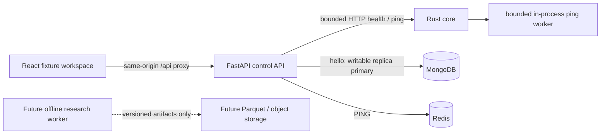

# Architecture

## Selected topology

One API facade and one deterministic-core foundation avoid redundant backends. Rust/Axum/Tokio handles bounded asynchronous messages and future safety-critical decisions. Python/FastAPI owns the control boundary and future research integration; it currently implements only health and ping. React/TypeScript/Vite owns presentation. Browser requests never address MongoDB or Redis directly. Vite development/preview proxies /api to the loopback API; production hosting/proxy/TLS is deliberately not deployed here.

The core is an ephemeral computation boundary, so its own readiness does not require MongoDB/Redis. The API reports separate dependency states and requires an actual writable `quantora-rs` primary plus Redis PING and compatible core readiness before returning READY. Database unavailability does not falsify liveness or chart fixture availability. No durable message or order success is acknowledged by foundation ping.

## Scope and future ownership

MongoDB is the confirmed primary application store. Future tenant records, encrypted-credential metadata, durable intents and financial/audit effects belong there; they are not implemented. A single-node local replica set supplies the topology needed for later transactions but is not high availability. Redis may cache/rebuild observations or transient hints; it cannot hold authoritative balances, intents or deduplication history. Parquet/object storage is a future immutable dataset interface, not a second application database.

Future research workers train offline, read permitted versioned datasets and publish candidate artifacts. They cannot call live dispatch or alter hard risk limits. Shared forecasting models do not imply shared tenant account state. Browser and LLM output have no order authority. NO_TRADE/FLAT are legal future intentions; CLOSE and opposite OPEN remain separate decisions. No loss-recovery or deadline-driven leverage behavior exists.

## Runtime boundaries selected in this phase

API: 32 in-flight admissions, 4096-byte body limit including streamed chunks, three-second request deadline, 0.8-second dependency probe budget, 0.6-second HTTP operation timeout, 16 HTTP connections/8 keepalive, database/Redis pools of eight, exact-origin CORS and no HTTP redirects. Core: 32 admissions, 4096-byte bodies, two-second body and two-second handler budgets, 32-message queue, 500ms worker reply budget. Excess work is rejected, not queued without limit. Health/ping do not retry failed requests automatically. UI polling is every five seconds with an 1800ms fetch timeout and rejects status older than ten seconds or over five seconds in the future.

These are engineering bounds, not proven market-response SLOs. Timings use monotonic clocks for durations; envelopes/log events use UTC Unix milliseconds. No horizon is inferred from processing latency. Full production freshness, capacity, risk and promotion budgets remain deferred in the original decisions. See recovery-and-observability.md.
